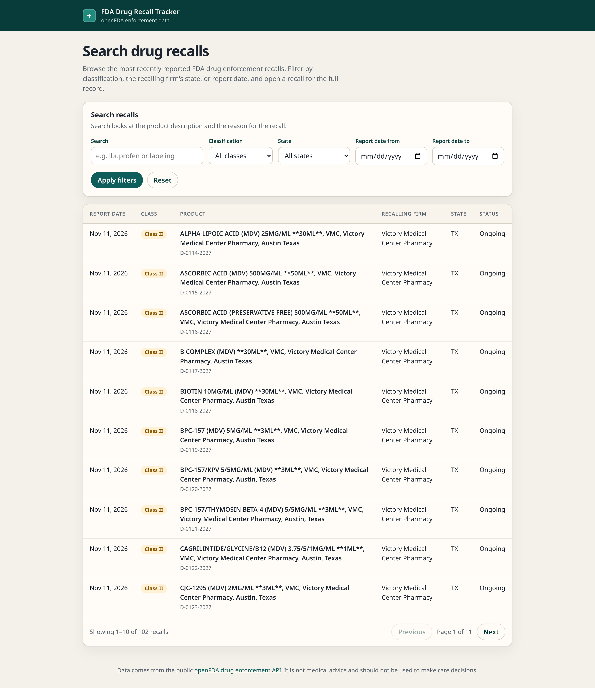
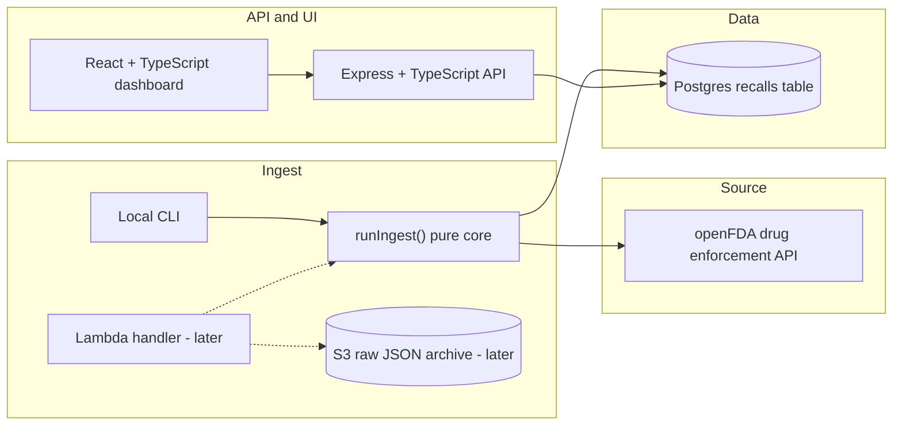

# FDA Drug Recall Tracker

A public portfolio project that pulls open [FDA drug enforcement](https://open.fda.gov/apis/drug/enforcement/) recall data, stores it in Postgres, and serves it through a typed Express API and a React + TypeScript dashboard.

The project is built so it can be talked through in a Senior Full Stack interview: how the ingest job pages a public API, how the schema and indexes are chosen, how the API queries are parameterized, how the dashboard keeps filters in the URL, and how CI runs against a real Postgres service.



## Architecture



The ingest core is a pure function. The local CLI (and, later, a Lambda handler) supply HTTP, database, and optional S3 dependencies. That keeps the paging and upsert logic testable without AWS.

The dashboard talks to the API through a typed client. In local development Vite proxies `/recalls` and `/health` to the API. A production build can point at a different origin with `VITE_API_BASE_URL`. Filters live in the URL, so a search is shareable and the back button works.

## Local setup

Prerequisites: Node.js 20+ (22 is what CI uses) and Docker, or any local Postgres 16+ you already have.

```bash
git clone https://github.com/anothermoth/fda-recall-tracker.git
cd fda-recall-tracker
cp .env.example .env
docker compose up -d
npm install
npm run migrate
npm run ingest -- --limit 200
npm run dev
```

`npm run dev` starts the API on `http://127.0.0.1:3001` and the dashboard on `http://127.0.0.1:5173`. You can also start them separately with `npm run dev:api` and `npm run dev:web`.

```bash
curl http://127.0.0.1:3001/health
curl "http://127.0.0.1:3001/recalls?q=ibuprofen&classification=Class%20II&limit=5"
curl http://127.0.0.1:3001/recalls/D-0145-2027
```

`GET /recalls` accepts:

| Query param | Meaning |
| --- | --- |
| `q` | Full-text search over product description and reason |
| `classification` | Exact match (`Class I`, `Class II`, `Class III`) |
| `state` | Exact match on the recalling firm's state |
| `from`, `to` | Inclusive `report_date` range (`YYYY-MM-DD`) |
| `limit`, `offset` | Pagination (`limit` defaults to 20, max 100) |

If you would rather not use Docker, create a database that matches `DATABASE_URL` in `.env` and run the same migrate / ingest / dev commands.

### Useful scripts

| Script | What it does |
| --- | --- |
| `npm run migrate` | Apply numbered SQL files in `db/migrations/` |
| `npm run ingest -- --limit 200` | Fetch the latest N openFDA records and upsert them |
| `npm run dev` | Start the API and the Vite dashboard together |
| `npm run dev:api` | Start only the API, with reload |
| `npm run dev:web` | Start only the dashboard (proxies API requests) |
| `npm test` | Unit, component, and API tests |
| `npm run typecheck` | `tsc --noEmit` in each package |
| `npm run lint` | ESLint across the repo |
| `npm run build` | Build every package, including the dashboard |

## Repository layout

```
packages/api       Express + TypeScript REST API
packages/ingest    openFDA fetch, mapping, upsert, and a future Lambda entry
packages/web       Vite + React + TypeScript dashboard
db/migrations      Plain, numbered SQL
docs/database.md   Schema, index rationale, and the read-only role
docs/dashboard.png Dashboard screenshot
```

## Roadmap

- [x] **Step 1** — Monorepo, Postgres schema and indexes, ingest CLI, Express API, tests, and GitHub Actions CI
- [x] **Step 2** — React + TypeScript (Vite) dashboard for search, filters, and recall detail
- [ ] **Step 3** — Expand `docs/database.md` with `EXPLAIN` plans, a backup/restore runbook, and a tighter roles model
- [ ] **Step 4** — Run the ingest job as an AWS Lambda, archive raw JSON pages to S3, and add a GitHub Actions deploy
- [ ] **Step 5** — Production hardening: read-only API credentials, structured logging, and a short operator README

## AI-assisted development

This project is built with AI pair-programming assistance. I direct the design, review every change, and am responsible for the code in this repository. The goal is to practice the same stack I use professionally and to have a public project I can walk through in interviews.

## License

[MIT](./LICENSE)
